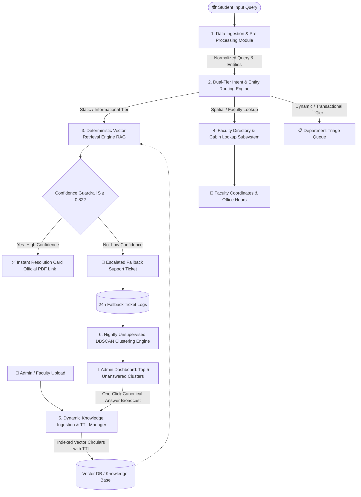
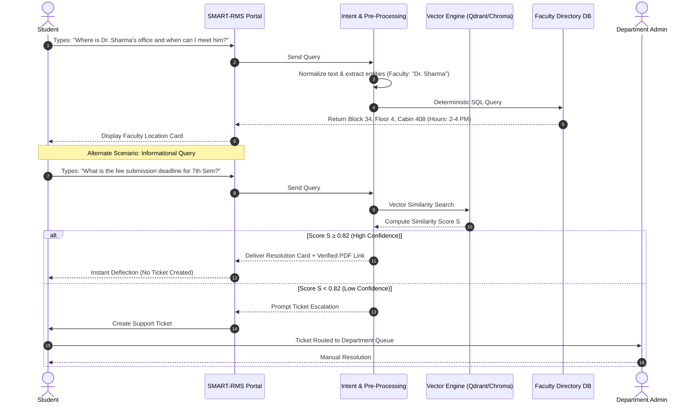

# 🎓 SMART-RMS

> **AI-Powered Query Deflection, Dynamic Knowledge Ingestion & Grievance Routing System for University Administration**

---

## 📌 Executive Summary

Modern university campuses function as massive, interdependent networks where academic schedules, examination schedules, fee deadlines, placement drives, and departmental offices must maintain seamless coordination. In traditional Relationship Management Systems (RMS), every student query enters a single, manual, linear ticketing queue—treating routine questions (e.g., *"When do mid-term exams start?"*) identically to complex personal grievances (e.g., *"Fee refund dispute due to billing error"*).

This legacy model creates severe operational friction:
* ⌛ **3–4 Day Latency**: Routine questions block urgent grievances.
* 🏫 **Campus Helpdesk Congestion**: Students crowd physical offices seeking quick answers.
* 🔄 **Information Decay**: Outdated or superseded circulars cause conflicting responses.
* 🤯 **Administrative Burnout**: Staff spend hours retyping identical responses to repetitive queries.

**SMART-RMS** resolves these challenges by introducing an **intelligent pre-ticket deflection layer**. Operating as an administrative copilot, SMART-RMS combines **Retrieval-Augmented Generation (RAG)** with strict confidence guardrails, deterministic relational directory lookups, dynamic document Time-To-Live (TTL) expiry management, and unsupervised density-based clustering (DBSCAN) to deflect up to 80% of routine inquiries in sub-second time while streamlining genuine grievance escalation for university authorities.

---

## 🎯 Key Project Objectives

1. **Unified Real-Time Knowledge & Directory Integration**
   Centralize university circulars, exam schedules, placement policies, and faculty office coordinates into a single, authoritative, real-time searchable repository.
2. **Sub-Second Pre-Ticket Deflection**
   Utilize semantic vector embeddings to analyze student query intent in real time, delivering verified resolution cards before a support ticket is created.
3. **Dynamic Knowledge Ingestion & Expiry (TTL)**
   Provide administrative staff with an intuitive portal to upload notices with explicit validity windows (TTL) and supersede tags, preventing stale data retrieval without re-training models.
4. **Unsupervised Clustering & Administrative Insights**
   Run nightly background clustering over unresolved/low-confidence queries using DBSCAN to identify emerging policy ambiguities and surface the **Top 5 Daily Unanswered Trends** on the admin dashboard.
5. **Human-Centered Triage & Dual-Tier Routing**
   Automatically direct actionable, account-specific disputes to assigned department heads while maintaining human authority over policy decisions and mark adjustments.
6. **Real-Time Attendance Monitoring & Predictive Planning**
   Provide real-time overall and subject-wise attendance tracking, calculate margin buffers for the 75% mandatory threshold, and send automated warning alerts.

---

## 🏗️ System Architecture

SMART-RMS is built on a modular, decoupled framework consisting of six specialized core engines:



---

## 🧩 Core Modules Breakdown

### 1. Data Ingestion & Query Pre-Processing Module
* **Input Normalization**: Cleans colloquial phrasing, corrects typos, and standardizes punctuation.
* **Acronym Expansion**: Expands university-specific jargon (e.g., `MTE` $\rightarrow$ Mid-Term Examination, `ETE` $\rightarrow$ End-Term Examination, `CA` $\rightarrow$ Continuous Assessment, `RP` $\rightarrow$ Re-appear Exam).
* **Named Entity Recognition (NER)**: Extracts key parameters such as course codes (`CSE339`), faculty names (`Dr. Sharma`), and department identifiers.

### 2. Dual-Tier Intent & Entity Routing Engine
Classifies queries into two operational pipelines:
* 🟢 **Informational / Static Tier**: Rule-based and factual questions routed to the semantic search and directory lookup engines.
* 🔴 **Transactional / Dynamic Tier**: Individual account issues (e.g., fee payment glitches, attendance discrepancies) requiring authorized human approval. These bypass conversational deflection and route straight to designated department heads.

### 3. Deterministic Vector Retrieval Engine (RAG with Confidence Guardrails)
* **Embedding Model**: Encodes queries into high-dimensional vector representations using Sentence Transformers.
* **Semantic Vector Search**: Computes Cosine Similarity ($S$) against indexed university circulars.
* **Confidence Threshold Enforcement ($S \ge 0.82$)**:
  * If $S \ge 0.82$: Returns an **Authoritative Resolution Card** containing exact policy excerpts and clickable links to the official PDF notice.
  * If $S < 0.82$: Prevents AI hallucination by declining to guess and seamlessly opening a ticket creation prompt.
* **Bounded Single-Turn Follow-Up**: Allows students to ask contextual follow-up questions strictly tied to the retrieved circular, avoiding uncontrolled chat drift.

### 4. Faculty Directory & Cabin Lookup Subsystem
* Executes deterministic SQL queries over a relational database to return exact spatial details for faculty inquiries:
  ```json
  {
    "faculty_name": "Dr. Sharma",
    "building_block": "Block 34",
    "floor": "4th Floor",
    "cabin_number": "Cabin 408",
    "consultation_hours": "14:00 - 16:00 (Mon, Wed, Fri)"
  }
  ```

### 5. Dynamic Knowledge Ingestion & Expiry (TTL) Manager
* **Admin Portal**: Enables staff to upload new FAQs, notices, and PDF circulars.
* **Time-To-Live (TTL) Expiration**: Each document includes a start date and expiry timestamp (`expiry_date`).
* **Supersede Override Tag**: Automatically invalidates older versions of circulars upon uploading newer revisions without requiring model re-training.
* **Vector Filtering**: Enforces active TTL tags at query time to ensure expired circulars are omitted from retrieval results.

### 6. Nightly Unsupervised Clustering & Administrative Action Portal
* **DBSCAN Clustering**: Analyzes all unhandled/low-confidence queries logged over the previous 24 hours.
* **Topic Aggregation**: Groups similar unresolved questions into dense semantic clusters.
* **Top 5 Daily Trends Broadcast**: Displays the Top 5 Unanswered Query Clusters on the Administrative Dashboard. Staff can publish a single canonical answer to resolve multiple matching tickets at once.

---

## 🔄 End-to-End Query Resolution Workflow



---

## 💻 Recommended Tech Stack

| Domain | Technology / Library |
| :--- | :--- |
| **Language & Backend** | Python 3.10+, FastAPI / Node.js |
| **Vector Database** | Qdrant / ChromaDB / Pgvector |
| **Relational Database** | PostgreSQL / SQLite |
| **Embeddings & NLP** | Sentence-Transformers (`all-MiniLM-L6-v2` or `bge-small-en-v1.5`), SpaCy |
| **Clustering Engine** | Scikit-Learn (DBSCAN), HDBSCAN |
| **Frontend UI** | HTML5, JavaScript, Vanilla CSS / Tailwind CSS |
| **Document Processing** | PyPDF2, pdfplumber, python-docx |

---

## 🌐 UN Sustainable Development Goals (SDGs) Alignment

SMART-RMS directly supports four key United Nations Sustainable Development Goals:

* 🎓 **SDG 4 — Quality Education**: Streamlines administrative assistance, ensuring students receive rapid, accurate information regarding their academic progress, attendance, and exam schedules.
* ⚙️ **SDG 9 — Industry, Innovation & Infrastructure**: Modernizes traditional campus governance through predictive AI infrastructure and automated query processing.
* ⚖️ **SDG 16 — Peace, Justice & Strong Institutions**: Promotes institutional transparency, verified policy dissemination, and accountable grievance routing with strict human oversight.
* 🤝 **SDG 17 — Partnerships for the Goals**: Enhances multi-departmental coordination across faculty, placement cells, and university leadership via a centralized administrative copilot.

---

## 📁 Repository Directory Structure

```
smart-rms/
├── README.md                           # Comprehensive Project Documentation
├── SMART-RMS_Problem_Statement_new.docx # Original Project Requirement Specification
├── docs/                               # System Design & Architecture Specifications
│   └── architecture_diagram.png
├── data/                               # Sample Ingestion Files & Documents
│   ├── circulars/                      # Official University Circular PDFs
│   └── faculty_directory.csv           # Faculty Seating & Office Hours Data
├── src/                                # Source Code Directory
│   ├── preprocessing/                  # Text Cleaning, Acronym Expansion & Entity Extraction
│   ├── intent_router/                  # Dual-Tier Intent & Routing Logic
│   ├── retrieval/                      # RAG Vector Search & Guardrail (S >= 0.82)
│   ├── faculty_lookup/                 # Deterministic SQL Faculty Directory Engine
│   ├── ttl_manager/                    # Knowledge Ingestion, TTL Expiration & Override Logic
│   └── clustering/                     # Nightly DBSCAN Unsupervised Clustering Engine
├── tests/                              # Unit & Integration Tests
└── requirements.txt                    # Python Dependencies
```

---

## 🚀 Quick Start Guide

### Prerequisites
* Python 3.10 or higher
* `pip` package manager

### Installation

1. **Clone the Repository**
   ```bash
   git clone https://github.com/yashrao11/smart-rms.git
   cd smart-rms
   ```

2. **Create a Virtual Environment**
   ```bash
   python3 -m venv venv
   source venv/bin/activate  # On Windows: venv\Scripts\activate
   ```

3. **Install Dependencies**
   ```bash
   pip install -r requirements.txt
   ```

4. **Run the Demonstration / Server**
   ```bash
   python3 src/main.py
   ```

---

## 🛡️ Guardrail Specifications

| Metric | Target / Threshold | Action |
| :--- | :--- | :--- |
| **Cosine Similarity ($S$)** | $S \ge 0.82$ | Display Resolution Card + PDF link |
| **Low Confidence ($S$)** | $S < 0.82$ | Refuse hallucination; offer ticket creation |
| **Response Latency** | $< 2.0$ seconds | Instant resolution delivery |
| **Document Expiry (TTL)** | Timestamp check | Omit expired documents from retrieval |

---

## 👥 Authors & Acknowledgments

* **Course**: Capstone Project-I (CSE339) — B.Tech 7th Semester
* **Project Title**: SMART-RMS (Smart Relationship Management System)
* **Repository**: [yashrao11/smart-rms](https://github.com/yashrao11/smart-rms)
